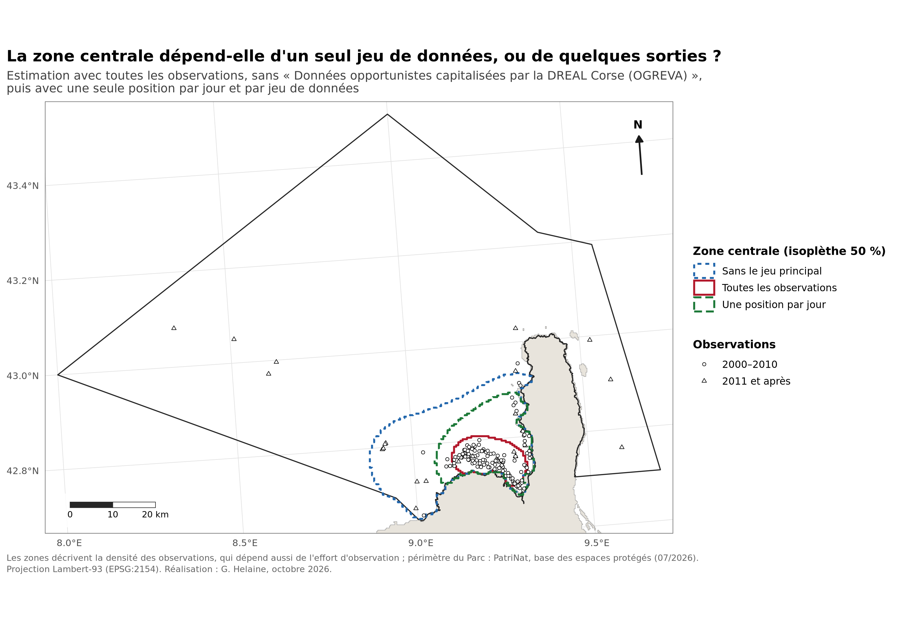

# Grand dauphin dans le PNM du Cap Corse et de l'Agriate : analyse exploratoire

Exercice personnel d'analyse de données ouvertes sur la répartition des observations de grand dauphin (*Tursiops truncatus*) dans le Parc naturel marin du Cap Corse et de l'Agriate et sur leur chevauchement avec le trafic maritime, réalisé dans le cadre d'une candidature au projet Delfinu.

**Auteure :** Gwladys Helaine — octobre 2026

## Deux versions

- **Version révisée, à lire en premier : [`v2/note.pdf`](v2/note.pdf).** La page 1 en donne la synthèse. Elle reprend l'exercice après l'envoi de la candidature, avec des contrôles supplémentaires.
- **Version jointe à la candidature : [`note.pdf`](note.pdf)**, conservée telle qu'envoyée, avec le code correspondant à la racine du dépôt.

  

<em>Version révisée : la zone centrale estimée avec toutes les observations, sans le jeu principal, puis avec une seule position par jour.</em>

## Ce qui change dans la version révisée

Après avoir appliqué la même démarche au Parc naturel marin d'Iroise ([delfinu-iroise](https://github.com/gwladys-helaine/delfinu-iroise)), j'ai identifié plusieurs limites de la première version. La version révisée, à partir des mêmes sources de données publiques, en tient compte :

- **Zones** : la concentration dans le golfe de Saint-Florent repose surtout sur quelques sorties d'un seul jeu de données (126 observations recueillies en 18 journées, de 2004 à 2007). Sans ce jeu, ou avec une seule position par jour, la zone centrale s'étend le long de l'Agriate et de la côte ouest du Cap Corse.
- **Trafic** : à distance de la côte comparable, la zone centrale n'est pas plus fréquentée par la plaisance et la voile que le reste de la bande côtière. L'écart de la première version tenait à la proximité de la côte.
- **Habitat** : comparées au seul plateau continental, les observations sont à peine plus côtières (2,5 km contre 3,8 km en médiane), un écart qui peut tenir aux observateurs.
- **Vocabulaire et contrôle qualité** : « zones de concentration des observations » remplace « domaine vital », trop fort pour des observations opportunistes ; deux contrôles mis au point en Iroise (positions sur une grille, doublons imprécis) ont été ajoutés.

## Contenu du dépôt

| Fichier | Rôle |
|---|---|
| `v2/note.pdf`, `v2/note.qmd` | Note révisée (PDF et source Quarto) |
| `v2/analyse.R` | Script révisé, adapté de celui de l'Iroise |
| `v2/observations_propres_parc.csv` | Observations nettoyées (161) |
| `v2/carte_robustesse.png` | Carte ci-dessus |
| `note.pdf`, `note.qmd`, `analyse.R` | Version jointe à la candidature (note et script) |
| autres `*.png`, `*.csv` | Cartes, graphiques et résultats chiffrés de la version jointe à la candidature |
| `delfinu-exercice.Rproj` | Projet RStudio |

## Reproduire l'analyse

Ouvrir `delfinu-exercice.Rproj` dans RStudio, déposer le périmètre du Parc (`sig_metrop.gpkg`, base des espaces protégés de PatriNat) dans `data/raw/parc/` et les rasters de densité de navires EMODnet dans `data/raw/trafic/`, puis lancer `v2/analyse.R` (ou `analyse.R` pour la première version). Le script télécharge les observations et la bathymétrie, et recrée les résultats dans `data/propre/` et `outputs/`. Les portails OBIS et GBIF étant alimentés en continu, un nouveau téléchargement peut donner des résultats légèrement différents.

## Sources et licences

Observations : OBIS, GBIF (dont base OGREVA de la DREAL Corse, Observatoire Pelagis, GIS3M, Tethys Research Institute) ; bathymétrie : NOAA ETOPO 2022 ; trafic : EMODnet Human Activities, densité de navires (AIS) 2023 ; périmètre : PatriNat, base des espaces protégés (07/2026).

Le code est librement réutilisable. Les observations restent soumises à la licence de leur jeu de données d'origine, indiquée sur OBIS et GBIF ; toute réutilisation doit citer ces jeux.

---
*Le code et les notes ont été réalisés avec l'aide d'un assistant d'IA (Claude, Anthropic). J'ai conduit la démarche, vérifié les données, les résultats et les références, et arbitré les choix de méthode et d'interprétation.*
